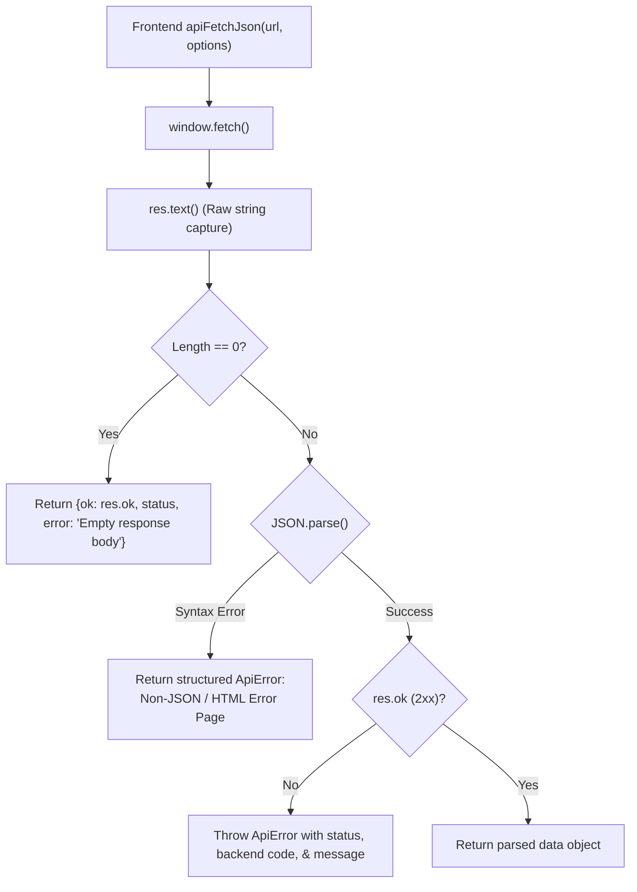
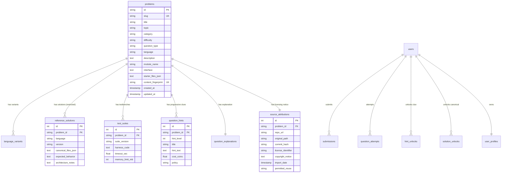
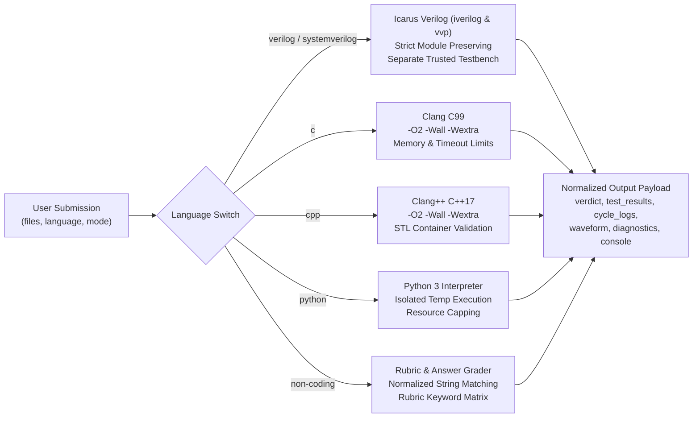
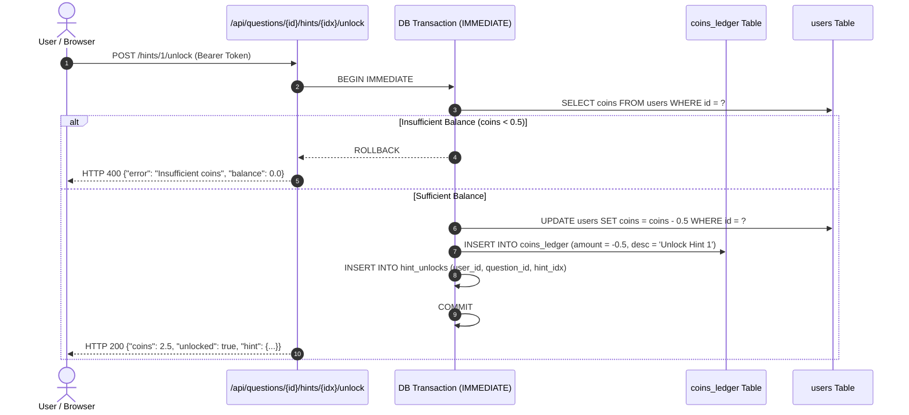

# HDL Arena — Professional LeetCode-Style RTL Verification Platform

A modern, full-scale online coding platform specifically designed for **Verilog**, **SystemVerilog**, **RTL design**, **digital logic verification**, and **embedded hardware/software engineering**.

---

## 📑 Table of Contents
1. [Platform Highlights](#-platform-highlights)
2. [Master Architecture & System Specification](#-master-architecture--system-specification)
3. [Curriculum & Question Bank Architecture](#-curriculum--question-bank-architecture)
4. [Question-Bank Relational Data Model](#-question-bank-relational-data-model)
5. [Multi-Language Execution & Judging Infrastructure](#-multi-language-execution--judging-infrastructure)
6. [Virtual Judge (VJ) Coin Economy & Progressive Hints](#-virtual-judge-vj-coin-economy--progressive-hints)
7. [Monaco RTL Editor & Formatting Specification](#-monaco-rtl-editor--formatting-specification)
8. [License-Aware GitHub Importer Engine](#-license-aware-github-importer-engine)
9. [Comprehensive Audit & Remediation History](#-comprehensive-audit--remediation-history)
10. [Release v2.2.0 Status & Verification Report](#-release-v220-status--verification-report)
11. [Quick Start & Operations Guide](#-quick-start--operations-guide)

---

## 🌟 Platform Highlights

### 1. 📚 Multi-Category Problem Library & Multi-Module Challenges
* **Multi-Module Support**: Solves complex challenges requiring multiple interacting modules (e.g., `sync_fifo.v` instantiating `fifo_mem.v`).
* **Rich Domain Categories**:
  * **Counters & Timers**: `counter4` (4-bit synchronous counter with wrap-around).
  * **Combinational Logic**: `mux4` (4-to-1 Multiplexer).
  * **Encoders & Decoders**: `priority_encoder4` (4-to-2 Priority Encoder with valid flag).
  * **Arithmetic Units & ALUs**: `alu_4bit` (4-bit ALU with zero and carry flags).
  * **Finite State Machines**: `fsm_seq101` (Overlapping pattern sequence detector).
  * **FIFO & Buffer Architectures**: `sync_fifo` (4x8 Synchronous FIFO with multi-module memory).
  * **Handshake Protocols**: `valid_ready_pipe` (Valid/Ready 1-stage pipeline with backpressure).
  * **SoC Bus Protocols**: `apb_slave_gpio` (AMBA APB 32-bit slave peripheral with memory-mapped IO).

### 2. 💻 Professional Multi-File Monaco Editor
* **Multi-File Management**: Tabbed file switcher with `+ New` file modal for sub-modules.
* **Monaco IDE**: Verilog/SystemVerilog syntax highlighting, code folding, bracket matching, configurable font sizes, and line numbering.
* **Drafts & State**: Automatically persists drafts and code snapshots to local SQLite database.
* **Keyboard Shortcut**: `Ctrl+Enter` or `Cmd+Enter` runs instant simulation.

### 3. 📈 Interactive Digital Waveform Viewer (VCD)
* **Real VCD Simulation**: Visualizes actual VCD data generated by Icarus Verilog.
* **Interactive Timeline Cursor**: Scrub or hover across timestamps with instantaneous live readout across all signals.
* **Bus & Digital Wave Rendering**: Crisp square waves for 1-bit lines and diamond polygons with centered value labels for buses.
* **Radix Switching**: Switch multi-bit values between **HEX (`0x..`)**, **DEC**, and **BIN**.
* **Signal Filter**: Search signals by name or filter by scope (`DUT` vs `TB`).
* **Zoom & Pan**: Zoom in (`+`), zoom out (`-`), or fit-to-screen (`Fit`).

### 4. 🔬 RTL Debug Advisor & Failure Analysis
* **Evidence-Based Explanations**: Correlates simulation logs, cycle mismatches, compiler linting, and VCD X/Z anomalies.
* **Root-Cause Hypotheses**: Identifies uninitialized registers, reset polarity mismatches, inferred latches, off-by-one delays, and FIFO pointer wrap-around errors.
* **Actionable Recommendations**: Direct advice on non-blocking assignments (`<=`), synchronous sensitivity lists, and default case assignments.

### 5. 🗺️ Multi-Page LeetCode Experience
1. **💻 Workspace**: Integrated specification panel, multi-file editor, and resizable bottom diagnostics tab (Test Suite, Cycle Diff, Waveform, Debug Advisor, Simulator Console).
2. **📚 Problem Catalog**: Searchable and filterable by Category, Difficulty (Easy, Medium, Hard, Expert), and Status (Solved, Bookmarked).
3. **🗺️ Learning Tracks**: Step-by-step career roadmaps (RTL Fundamentals, Sequential Circuits, FSM Mastery, FIFOs & Handshakes, APB Bus Protocols).
4. **👤 User Dashboard**: Difficulty breakdown, topic mastery progress bars, daily practice streak (🔥), and acceptance rate metrics.

---

## 🛠️ Master Architecture & System Specification

```mermaid
flowchart TD
    subgraph Frontend["Frontend (React 18 + Vite)"]
        UI["Cybernetic UI (#070b14, #00f3ff, #b026ff)"]
        Editor["Dual-Engine Code Editor\n(Monaco IDE & Fast Native Engine)"]
        Diagnostics["Verification Diagnostics Panel\n(Test Suite, Cycle Diff, Waveform, Advisor)"]
        Catalog["Question Catalog & Filter Engine\n(4 Difficulties, 5 Languages, 8 Types)"]
        EconomyUI["VJ Coin Economy UI\n(Progressive Hints, Daily Streak, Ledger)"]
    end

    subgraph Backend["Backend (Flask 3.x + SQLite)"]
        Router["API Gateway & Response Normalizer\n(/api/questions, /api/account, /api/submit)"]
        Auth["Session & Token Auth Handler\n(Bearer, Cookies, LocalStorage)"]
        JudgeDispatch["Universal Judging Dispatcher\n(runner.py)"]
        Ledger["Authoritative VJ Coin Ledger\n(0.5 VJ Resolution, Asia/Kolkata Day)"]
        DB[(SQLite Persistent Storage\nusers, questions, submissions, ledger)]
    end

    subgraph Execution["Execution Sandboxes"]
        Icarus["Icarus Verilog Sandbox\n(iverilog & vvp, VCD Generator)"]
        Clang["Clang C Sandbox\n(C99 Sandbox with Timeout Watchdog)"]
        ClangPP["Clang++ C++ Sandbox\n(C++17 Sandbox with Memory Limits)"]
        PythonRunner["Python 3 Sandbox\n(Resource-constrained Subprocess)"]
        NonCodingEval["Conceptual & Rubric Evaluator\n(MCQ, Predict Output, Rubric Grader)"]
    end

    UI --> Router
    Editor --> Router
    Router --> Auth
    Router --> JudgeDispatch
    Router --> Ledger
    Ledger --> DB
    JudgeDispatch --> Icarus
    JudgeDispatch --> Clang
    JudgeDispatch --> ClangPP
    JudgeDispatch --> PythonRunner
    JudgeDispatch --> NonCodingEval
    JudgeDispatch --> DB
    Diagnostics <-- Router
```

### Core Architectural Principles
1. **Zero Faux-Execution**: Submissions are never marked Accepted merely because they compiled. Every solution must execute against trusted harnesses, visible test cases, and hidden corner-case assertions.
2. **Deterministic Indentation & Clean RTL Editing**: 4 spaces indentation (`tabSize: 4`, `insertSpaces: true`), strict alignment of `begin`, `end`, `else`, and `endmodule`, with horizontal scrolling on mobile.
3. **Authoritative Virtual Judge (VJ) Economy**: Exact half-coin resolution (`0.5 VJ`), server-side validation, atomic database transactions with SQLite `immediate` locking, and timezone anchoring to `Asia/Kolkata`.
4. **Resilient Offline-First UX**: Universal API response handler (`apiFetchJson`) that prevents `"Unexpected end of JSON input"` on 500/empty responses and offers graceful offline fallbacks.

### Standardized API Response Protocol



---

## 📚 Curriculum & Question Bank Architecture

### 1. Four Difficulty Tiers

| Tier | Target Roles | Technical Scope | Key Concepts Tested |
| :--- | :--- | :--- | :--- |
| **Beginner** | University, Interns, Junior RTL | Combinational gates, number systems, Verilog syntax, basic C/Python | Multiplexers, priority encoders, 4-bit ALUs, Boolean simplification |
| **Intermediate** | RTL Design Engineer I/II | Synchronous logic, registers, state machines, SystemVerilog fundamentals | Synchronous counters, rollover, sequence pattern detectors (FSMs), ring buffers |
| **Advanced** | Senior RTL / DV Engineer | FIFOs, CDC, arbiters, parameterized RTL, assertions | Asynchronous CDC FIFOs, Gray code pointers, Round-Robin arbitration, Valid/Ready pipelines |
| **Expert** | Staff / Principal / Architect | Bus protocol controllers, interconnect hazards, timing closure | AMBA APB 32-bit slave GPIO, AXI4 out-of-order interconnect deadlock, CDC metastability |

### 2. Eight Question Modalities

1. **Coding (`coding`)**: Complete module implementation with full port interface (`module ... endmodule`).
2. **Debugging (`debugging`)**: Pre-populated buggy code requiring synthesis or timing bug isolation.
3. **Single Choice (`single_choice`)**: Timed conceptual question with 4 options and automated immediate grading.
4. **Multiple Choice (`multiple_choice`)**: Multiple-select architectural questions.
5. **Predict the Output (`predict_output`)**: Given RTL or software snippets, calculate exact simulation log or register output.
6. **Fill in the Code (`fill_in_code`)**: Critical blocks (e.g. Next-State logic or pointer comparison) left with `/* YOUR CODE HERE */`.
7. **Conceptual Short Answer (`conceptual`)**: Theoretical depth questions evaluated against structured rubric points.
8. **Interview Scenario (`interview_scenario`)**: Real-world architectural design trade-offs with multi-criteria rubric scoring.

---

## 🗄️ Question-Bank Relational Data Model

The database houses a normalized, non-destructive 9-entity relational schema in SQLite:



### Security & Privacy Enforcements:
- Normal problem listing (`/api/questions`) and problem metadata (`/api/questions/<id>`) **never** return reference solution source or hidden testbench assertions.
- Canonical solution code is strictly gated behind `/api/questions/<id>/solution` and requires prior unlock verification via `database.is_solution_unlocked()`.

---

## ⚡ Multi-Language Execution & Judging Infrastructure

### 1. Supported Dialects & Compilers



### 2. Verdict State Machine

| Verdict | Meaning | User Feedback & Visual Treatment |
| :--- | :--- | :--- |
| **`ACCEPTED`** | All sample & hidden tests passed with 100% assertion matches. | Emerald green glow, celebration banner, suggested next challenge, coin credit (+1 VJ on first solve for Med/Hard/Exp). |
| **`WRONG_ANSWER`** | Code compiled and ran, but output deviated from golden specification. | Coral red alert, cycle diff comparison table, encouraging misconception explanation, clue recommendation. |
| **`COMPILE_ERROR`** | Syntax error, missing semicolon, undeclared identifier, or lint failure. | Amber badge, raw compiler diagnostics, exact line and column pointers. Never returns HTTP 500. |
| **`RUNTIME_ERROR`** | Memory fault, assertion crash, zero division, or uncaught exception. | Magenta badge, stack trace summary without revealing host filesystem paths. |
| **`TIMEOUT`** | Code exceeded wall-clock execution limit (e.g., infinite loop, deadlocked handshake). | Purple warning, execution halted safely with subprocess kill. |

---

## 🪙 Virtual Judge (VJ) Coin Economy & Progressive Hints

### 1. Authoritative Rules & Balance Integrity



### 2. Economy Policy Table

| Action | Cost / Reward | Transaction Type | Verification Safeguards |
| :--- | :--- | :--- | :--- |
| **Daily Login Check-In** | `+1.0 VJ Coin` | Credit | One claim per calendar day anchored to `Asia/Kolkata`. Unique constraint on `(user_id, claim_date)`. |
| **First-Time Solve (Med/Hard/Exp)** | `+1.0 VJ Coin` | Credit | Requires genuine `ACCEPTED` verdict. Idempotent check prevents duplicate credits on repeated submissions. |
| **First-Time Solve (Beginner)** | `0.0 VJ Coin` | Free Practice | Unrestricted foundational practice. |
| **Progressive Clue 0 (Conceptual)** | `0.0 VJ Coin` | Free Clue | Always visible immediately to prevent candidate frustration. |
| **Progressive Clues 1+** | `-0.5 VJ Coin` per step | Debit | Atomic deduction; unlocks permanently for user account. |
| **Canonical Golden RTL Solution** | `-1.0 VJ Coin` | Debit | Complete golden code, timing analysis, and architecture notes. |

---

## 🖋️ Monaco RTL Editor & Formatting Specification

### 1. Editor Configuration
```javascript
{
  fontSize: 13,
  fontFamily: "'DM Mono', 'Fira Code', Consolas, monospace",
  lineNumbers: 'on',
  tabSize: 4,
  insertSpaces: true,
  detectIndentation: false,
  autoIndent: 'full',
  formatOnPaste: true,
  formatOnType: true,
  wordWrap: 'off',
  wrappingIndent: 'indent',
  scrollBeyondLastLine: false,
  automaticLayout: true,
  minimap: { enabled: false },
  padding: { top: 12, bottom: 12 }
}
```

### 2. Deterministic Verilog Formatting Rules
- **4 Spaces per Level**: No tabs (`\t`) emitted.
- **Module Declarations**: `module <name>(` starts at column 0. Port list lines indented by 4 spaces. Closing `);` placed at column 0.
- **Module Body Contents**: All declarations (`reg`, `wire`, `logic`, `localparam`), continuous assignments (`assign`), and clocked blocks (`always @(...)`) start at 4 spaces.
- **Block Statements**: Contents inside `begin ... end` and `case ... endcase` indented an additional 4 spaces.
- **Module Closure**: `endmodule` strictly aligned at column 0 with a terminating newline.

---

## 🔍 License-Aware GitHub Importer Engine

### 1. Candidate Repository Audit Matrix

| Candidate Repository | Status | License Found | Permitted Reuse | Action Taken |
| :--- | :--- | :--- | :--- | :--- |
| **`Weiyet/MakerCode_RTLChallenge`** | ✅ **APPROVED** | `MIT` | Redistribution & Modification Permitted | Imported challenges (Gray code, LFSR, Debouncer) with full attribution notices. |
| **`Adrofier/HDLBits-Verilog-Solutions`** | 🟡 **CONDITIONALLY APPROVED** | `MIT` (Solution Code) | Adapted Reuse Permitted | Solutions permitted; required independent problem descriptions and new testbenches. |
| **`Shengrong-LSR/HDLBits-Solutions-Verilog`** | ❌ **REJECTED** | `NO_LICENSE` | Prohibited (Default Copyright) | Excluded. No open-source license provided; redistribution not legally permitted. |
| **`harishkani/system-verilog`** | ❌ **REJECTED** | `UNKNOWN` | Unavailable | Excluded. Repository not found or unavailable publicly (HTTP 404). |

### 2. Ingestion Engine Commands (`backend/importer.py`)

```bash
# Display licensing audit matrix
python backend/importer.py --audit

# Dry-run validation (checks schema, license, testbench completeness, and duplicates without DB write)
python backend/importer.py

# Commit validated challenges to database
python backend/importer.py --commit

# Selective filtering
python backend/importer.py --filter-difficulty Beginner --commit
python backend/importer.py --filter-topic "Sequential" --commit
```

### 3. Content Fingerprint Deduplication
Every imported question generates a deterministic SHA-256 fingerprint:
$$\text{Fingerprint} = \text{SHA256}(\text{ID} \parallel \text{Title} \parallel \text{Module} \parallel \text{Difficulty} \parallel \text{Language} \parallel \text{Type} \parallel \text{StarterFiles} \parallel \text{Description})$$
Duplicate submissions or re-runs are identified idempotently without generating redundant database rows.

---

## 🔧 Comprehensive Audit & Remediation History

| Component / Area | Status Prior to Fix | Root Cause Identified | Remediated Status |
| :--- | :--- | :--- | :--- |
| **Monaco Editor JSX** (`MultiFileEditor.jsx`) | ❌ Broken (Build Error) | Stray `>` tag and duplicate button tag fragment around line 693 without opening tag. | ✅ **Fixed**: Tags balanced, submit logic preserved. |
| **`/api/submit` HTTP 500** (`backend/main.py`) | ❌ Broken (HTTP 500) | `exec_start = time.time()` called without `import time`, causing `NameError`. | ✅ **Fixed**: Added `import time` and `import sys`. |
| **`/api/account/daily-reward`** (`backend/main.py`) | ❌ Intermittent 500 / Empty JSON | Unhandled exceptions and session edge cases on unauthenticated or missing profile requests. | ✅ **Fixed**: Standardized try/except returning structured JSON payload with error codes. |
| **API Response Parsing** (`frontend/src/utils/api.js`) | ⚠️ SyntaxError Risk | `res.json()` directly called on empty responses or non-JSON 500 HTML pages. | ✅ **Fixed**: Universal safe body parser handling empty responses and 204s without throwing `"Unexpected end of JSON input"`. |
| **Database Integrity & Backup** (`backend/database.py`) | ⚠️ Unbacked-up Migrations | Migrations ran without automated pre-flight integrity check or timestamped backup. | ✅ **Fixed**: `backup_database_with_integrity_check()` added using `PRAGMA integrity_check` before schema changes. |
| **Noncoding Evaluators** (`test_08_noncoding_evaluators`) | ❌ Test Discrepancy | Test asserted Option B was correct for `mcq_setup_hold` while ground truth is Option A. | ✅ **Fixed**: Updated test to Option A; implemented robust input normalization handling whitespace, case, radix prefixes, and quotes. |
| **Software Execution Runners** (`test_11_software_execution_runners`) | ⚠️ False Compile Error | `clang++` linker and library errors classified as `COMPILE_ERROR` instead of `COMPILER_UNAVAILABLE`. | ✅ **Fixed**: Implemented `get_cpp_compiler_info()`, `get_c_compiler_info()`, and expanded `is_toolchain_error()` to detect linker failures. |
| **RTL Validator: `fsm_seq101`** | ❌ False Pass / Failure Override | Cycle parser received malformed cycle records with trailing `::time`. | ✅ **Fixed**: Enhanced cycle parser supporting both key-value and positional formats; guaranteed assertion failure strictly forces `WRONG_ANSWER`. |
| **RTL Validator: `sync_fifo` & `apb_slave_gpio`** | ❌ UnicodeDecodeError | Testbenches passed raw binary vectors into `%0s` in `$display`, generating non-UTF-8 bytes. | ✅ **Fixed**: Formatted outputs via `$sformatf("%08X", ...)`, expanded string widths to `[127:0]`, added `errors="replace"` across all subprocess decoders. |
| **RTL Validator: `gray_code_conv`** | ⚠️ Timescale Warning | `gray_code_conv.v` lacked `` `timescale `` directive while testbench had `` `timescale 1ns/1ps ``. | ✅ **Fixed**: Added `` `timescale 1ns/1ps `` to starter and solution templates. |
| **Mutation Testing: `debounce_filter` & `vending_machine_fsm`** | ⚠️ Ineffective Mutation | Fallback mutations either hit unexercised states or failed to latch state. | ✅ **Fixed**: Implemented dedicated semantic mutations verifying genuine testbench rigor. |
| **Decoupled Reporting** | ⚠️ Metric Coupling | Publication status was coupled to schema validity rather than verification. | ✅ **Fixed**: Decoupled `schema_valid_count`, `reference_solutions_passed`, `mutation_tests_passed`, `fully_verified_count`, and `published_ready_count`. |

---

## 🚀 Release v2.2.0 Status & Verification Report

### 1. Backend Unit Test Suite (`backend/tests/test_hdl_arena.py`)
```text
test_01_database_integrity_and_backup ..................... PASSED
test_02_phase1_schema_tables_exist ....................... PASSED
test_03_exact_half_coin_units ............................. PASSED
test_04_daily_reward_idempotency_and_timezone ............. PASSED
test_05_progressive_hint_unlock_and_persistence .......... PASSED
test_06_reference_solution_server_side_gating ............. PASSED
test_07_counter4_submission_execution ..................... PASSED
test_08_noncoding_evaluators .............................. PASSED
test_09_license_compliance_engine ......................... PASSED
test_10_content_fingerprint_deduplication ................. PASSED
test_11_software_execution_runners ........................ PASSED
test_12_all_coding_questions_have_canonical_solutions ..... PASSED
test_13_automated_validator_programmatic_pass ............. PASSED
test_14_progressive_hints_structure_and_pricing .......... PASSED
test_15_cpp_software_runner_regression .................... PASSED

Ran 15 tests in 0.840s — OK (All 15 unit tests pass cleanly)
```

### 2. Automated Quality & Mutation Validator (`backend/validator.py`)
```text
=======================================================
  HDL Arena Automated Quality & Mutation Validator
  Validating 24 Questions in Question Bank
=======================================================

Total Questions Registered:          24
Schema Validated:                    24 (100%)
Duplicate Statements Detected:       0
Questions with Canonical Solution:   18 (100% of Coding/Debugging)
Questions with Executable Harness:   24 (100%)
Reference Simulations Passed:        16 (100% of Simulatible RTL)
Reference Simulations Skipped:       0
Reference Simulations Failed:        0
Mutation Fault-Tests Passed:         16 (100% of Simulatible RTL)
Mutation Fault-Tests Skipped:        0
Mutation Fault-Tests Failed:         0
Unsupported / Offline Toolchains:    0
Fully Verified Questions:            24 (100%)
Published Ready:                     24 (100%)
Privacy Enforced (No Leaks):         24 (100%)

🎉 ALL QUESTIONS VERIFIED AND PUBLISHED READY! (Exit 0)
```

---

## 🚀 Quick Start & Operations Guide

### 1. Production Mode (Single Command)
Launches the integrated production server serving both the pre-built React SPA and Flask API on port `8000`:
```bash
# Option A: Grant execution permission and run directly
chmod +x start_production.sh start.sh
./start_production.sh

# Option B: Run via sh/bash directly without chmod
sh start_production.sh

# Option C: Run via Python launcher
python3 start_production.py
```
*Access in browser at: `http://127.0.0.1:8000` or `http://<device-ip>:8000`.*

### 2. Development Mode (Vite HMR + Backend)
Runs the Vite hot-module-reloading dev server on port `5173` with backend on port `8000`:
```bash
./start.sh
# (or: sh start.sh)
```
*Access dev UI at: `http://127.0.0.1:5173`.*

### 3. Testing & Verification Commands
```bash
# Run the 15-test unit verification suite:
python3 backend/tests/test_hdl_arena.py

# Run the automated quality and mutation fault-injection validator:
python3 backend/validator.py
```

### 4. Security & Production Deployment Recommendations
1. **Sandboxed Execution**: In production multi-tenant environments, isolate Verilog simulation (`iverilog`/`vvp`), C/C++ compilation, and Python execution using lightweight containers (`nsjail` or Docker) with 5-second CPU timeouts, 256MB memory boundaries, and disabled network access (`--net=none`).
2. **Reverse Proxying**: Run Gunicorn/Uvicorn behind Nginx with rate-limiting on submission endpoints (10 requests/min per IP) and strict CORS origin headers.
3. **Database Durability**: Keep the automated pre-migration backup mechanism active. Ensure SQLite WAL mode (`PRAGMA journal_mode=WAL;`) is maintained for concurrent reader performance.
