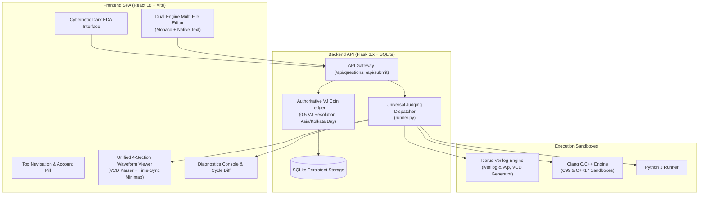

# ⚡ HDL Arena — Professional LeetCode-Style RTL Verification Platform

[](https://vijayabala-v.github.io/HDL-Arena/)
[](https://react.dev/)
[](https://vitejs.dev/)
[](https://steveicarus.github.io/iverilog/)
[](https://microsoft.github.io/monaco-editor/)
[](https://github.com/VijayaBala-V/HDL-Arena)
[](LICENSE)

> A modern, full-scale online coding and EDA evaluation platform engineered for **Verilog**, **SystemVerilog**, **RTL design**, **digital logic verification**, and **embedded hardware/software co-design**.

---

## 🌐 Live Website & Hosting

* **Live Demo (GitHub Pages):** [https://vijayabala-v.github.io/HDL-Arena/](https://vijayabala-v.github.io/HDL-Arena/)
* **GitHub Repository:** [https://github.com/VijayaBala-V/HDL-Arena](https://github.com/VijayaBala-V/HDL-Arena)
* **Author:** [VijayaBala-V](https://github.com/VijayaBala-V) (`vijayabala842@gmail.com`)

### Repository Short Description (GitHub About)
> *Interactive LeetCode-style EDA verification platform for Verilog & SystemVerilog with unified 4-section waveform viewer, dual Monaco editor, automated testbenches, and VJ coin economy.*

### Recommended GitHub Topics / Tags
`verilog` • `systemverilog` • `eda` • `hardware-description-language` • `rtl-design` • `waveform-viewer` • `digital-logic` • `leetcode` • `monaco-editor` • `icarus-verilog` • `react` • `vite` • `python` • `flask`

---

## 📑 Table of Contents
1. [Platform Highlights & Latest Improvements](#-platform-highlights--latest-improvements)
2. [Master Architecture](#-master-architecture)
3. [Unified 4-Section Waveform Viewer](#-unified-4-section-waveform-viewer)
4. [IDE & Language Environment System](#-ide--language-environment-system)
5. [User Credential & Profile Management](#-user-credential--profile-management)
6. [Curriculum & Question Bank](#-curriculum--question-bank)
7. [Virtual Judge (VJ) Coin Economy](#-virtual-judge-vj-coin-economy)
8. [Hosting on GitHub Pages (Deployment Guide)](#-hosting-on-github-pages-deployment-guide)
9. [Quick Start & Local Development](#-quick-start--local-development)
10. [Test & Verification Suite](#-test--verification-suite)

---

## 🌟 Platform Highlights & Latest Improvements

### 1. 📈 Unified 4-Section EDA Waveform Viewer
* **Single-Container Architecture**: Consolidates all critical simulation traces into **one synchronized EDA viewer** without disjointed windows or separate cards.
* **Synchronized Time Axis**: Unified 0ns – MaxTime timeline scrubbing with interactive minimap and cursor readouts.
* **The 4 Essential Waveform Sections**:
  1. **Golden Wave (Input)**: Input stimuli and clocks (`clk`, `rst_n`, data inputs) rendered in cyan (`#38bdf8`).
  2. **Golden Wave (Output)**: Reference model expected outputs rendered in emerald (`#10b981`).
  3. **Match or Not (Single Bit)**: 1-bit comparator track displaying **MATCH** in vibrant green (`#10b981`) and **MISMATCH** in bright red (`#ef4444`) with shaded comparison fills and instantaneous cursor status.
  4. **Your Wave (Output)**: Simulated DUT waveforms rendered in purple (`#a855f7`).
* **Interactive Controls**: Bus expansion/collapse (`[+] / [-]`), Radix switching (**HEX**, **DEC**, **BIN**, **ASCII**), Zoom in/out/fit, and one-click **"🚨 Jump to Divergence"** navigation.

### 2. ⚡ Dynamic IDE Selection Dropdown
* Replaces static option lists with a modern, compact IDE selector.
* Seamlessly toggles simulation and toolchain contexts:
  * **Verilog / HDL IDE**: Icarus Verilog simulation engine.
  * **C / C++ IDE**: Clang C99 & Clang++ C++17 verification models.
  * **Python IDE**: Python 3 testbench scripting.
  * **Java IDE**: JVM-based verification environments.

### 3. 📏 Configurable Workspace Output Sizing
* Compact dropdown selector allowing developers to adjust workspace height density to **540px**, **640px**, or **840px**.
* Automatically reflows Monaco Editor, tab bars, and diagnostics panels using `ResizeObserver`.

### 4. 🛡️ Strict Programming Language Filtering
* Enforces rigorous language-to-environment dependencies in `environments.js`.
* Selecting **Verilog / HDL IDE** strictly filters options to **Verilog (IEEE 1364)** and **SystemVerilog (IEEE 1800)**, completely hiding non-HDL languages and safeguarding state integrity.

### 5. 👤 Modular User Credential & Profile Area
* Prepares the interface for scalable authentication and account administration.
* Includes a compact navbar avatar pill, user profile info, and modular flyout menus:
  * **User Profile**: Personal identity and verification engineer bio.
  * **Password & Credentials**: Security keys and authentication settings.
  * **Account Preferences**: Editor theme (`vs-dark`), keybindings, and formatting preferences.
  * **Saved IDE & Language**: Preferred default development configurations.

### 6. 💻 Dual-Engine Multi-File Code Editor
* **Monaco IDE**: Verilog & SystemVerilog syntax highlighting, 4-space auto-indentation, bracket matching, line numbering, and `Ctrl+Enter` simulation shortcut.
* **Fast Native Text Mode**: Instant lightweight fallback for low-latency or resource-constrained devices.
* **Multi-File Module Management**: Tabbed file switcher supporting hierarchical multi-module designs (e.g. `sync_fifo.v` instantiating `fifo_mem.v`).

---

## 🛠️ Master Architecture



---

## 📈 Unified 4-Section Waveform Viewer

The waveform engine transforms standard VCD (Value Change Dump) traces into an interactive, synchronized comparison view:

```
┌────────────────────────────────────────────────────────────────────────┐
│  UNIFIED WAVEFORM VIEWER (0ns — 180ns)        [Radix: HEX] [Zoom: 1.0x]│
├────────────────────────────────────────────────────────────────────────┤
│ 1. Golden Wave (Input)                                                 │
│    clk      ───┐   ┌───┐   ┌───┐   ┌───┐   ┌───┐   ┌───┐   ┌───┐   ┌───│
│    rst_n    ───────┘                                                   │
├────────────────────────────────────────────────────────────────────────┤
│ 2. Golden Wave (Output)                                                │
│    dout[3:0] < 0x0 >< 0x1 >< 0x2 >< 0x3 >< 0x4 >< 0x5 >< 0x6 >< 0x7 > │
├────────────────────────────────────────────────────────────────────────┤
│ 3. Match or Not (Single Bit)                                           │
│    STATUS   █████████████████████████████████████░░░░░░████████████████│
│             [✓ MATCH (Green)]                    [✗ MISMATCH (Red)]    │
├────────────────────────────────────────────────────────────────────────┤
│ 4. Your Wave (Output)                                                  │
│    dout[3:0] < 0x0 >< 0x1 >< 0x2 >< 0x3 >< 0x4 >< 0x0 >< 0x6 >< 0x7 > │
└────────────────────────────────────────────────────────────────────────┘
```

* **Timeline Scrubbing**: Clicking anywhere on the minimap or waveform moves the synchronized golden cursor across all 4 sections simultaneously.
* **Divergence Highlighting**: When your output deviates from golden output, a red guideline and jump button instantly navigate to the exact cycle of failure.

---

## 🌐 Hosting on GitHub Pages (Deployment Guide)

The frontend is configured with relative base asset paths (`base: './'`) in `frontend/vite.config.js` and automated with a GitHub Actions workflow.

### Automated Deployment via GitHub Actions (Enabled)
Every push to the `main` branch automatically triggers `.github/workflows/deploy.yml` which:
1. Checks out the repository.
2. Installs dependencies (`npm ci`).
3. Builds the production bundle (`npm run build`).
4. Deploys `frontend/dist` to **GitHub Pages**.

### One-Time GitHub Repository Activation:
1. Navigate to your repository on GitHub: `https://github.com/VijayaBala-V/HDL-Arena`
2. Click **Settings** (top navigation tab).
3. In the left sidebar, click **Pages**.
4. Under **Build and deployment → Source**, select **GitHub Actions**.
5. Your website will be live at:
   ```text
   https://vijayabala-v.github.io/HDL-Arena/
   ```

---

## 💻 IDE & Language Environment System

| Environment | Default Dialect | Supported Dialects | Execution Engine |
| :--- | :--- | :--- | :--- |
| **Verilog / HDL IDE** | Verilog | `Verilog (IEEE 1364)`, `SystemVerilog (IEEE 1800)` | Icarus Verilog (`iverilog`, `vvp`) |
| **C / C++ IDE** | C++ | `C (Clang C99)`, `C++ (Clang++ C++17)` | Clang Toolchain |
| **Python IDE** | Python 3 | `Python 3` | CPython Sandbox |
| **Java IDE** | Java | `Java (OpenJDK 17)` | JVM Sandbox |

---

## 🪙 Virtual Judge (VJ) Coin Economy

HDL Arena integrates a fair, gamified economy to encourage continuous practice:
* **🔥 Daily Login Streak**: Earn `+1.0 VJ Coin` each calendar day (anchored to `Asia/Kolkata`).
* **🎯 First-Time Solve Bounties**: Earn `+1.0 VJ Coin` for your first accepted solve on Intermediate, Advanced, and Expert problems.
* **💡 Progressive Clues**:
  * *Hint 0 (Conceptual)*: Free (`0.0 VJ`).
  * *Hint 1 (RTL Clue)*: `0.5 VJ`.
  * *Hint 2 (Implementation)*: `0.5 VJ`.
* **📖 Canonical Solution Unlock**: Unlock full golden RTL, architecture notes, and timing analysis for `1.0 VJ`.

---

## 📚 Curriculum & Question Bank

### 1. Difficulty Tiers
* **Beginner**: Combinational gates, muxes, priority encoders, 4-bit ALUs.
* **Intermediate**: Synchronous counters, LFSRs, sequence pattern detectors (FSMs), ring buffers.
* **Advanced**: Synchronous/Asynchronous FIFOs, Gray code converters, round-robin arbiters, Valid/Ready pipelines.
* **Expert**: AMBA APB 32-bit slave peripherals, memory-mapped I/O, CDC synchronization, bus interconnects.

### 2. Question Modalities
1. **Coding (`coding`)**: Full module implementation with port declarations.
2. **Debugging (`debugging`)**: Pre-populated buggy code requiring synthesis or timing bug isolation.
3. **Single Choice (`single_choice`)**: Timed conceptual digital logic questions.
4. **Multiple Choice (`multiple_choice`)**: Multi-select architectural questions.
5. **Predict the Output (`predict_output`)**: Compute exact register states or simulation cycle outputs.
6. **Fill in the Code (`fill_in_code`)**: Critical next-state logic or pointer checks.
7. **Conceptual Short Answer (`conceptual`)**: Theoretical depth questions graded against rubric criteria.
8. **Interview Scenario (`interview_scenario`)**: Real-world hardware trade-offs and architectural designs.

---

## 🚀 Quick Start & Local Development

### Prerequisites
* **Node.js** (v18 or higher) & **npm**
* **Python** (v3.10 or higher)
* **Icarus Verilog** (`iverilog` and `vvp` in system PATH)

### 1. Run Frontend Development Server
```bash
cd frontend
npm install
npm run dev
```
*Access in browser:* `http://localhost:5173`

### 2. Run Backend API Server
```bash
python -m pip install -r backend/requirements.txt
python backend/main.py
```
*Backend runs on:* `http://127.0.0.1:8000`

### 3. Build Production Bundle
```bash
cd frontend
npm run build
```
Generates production assets in `frontend/dist/`.

---

## 🧪 Test & Verification Suite

HDL Arena features a comprehensive 15-test automated verification suite and mutation fault-injection testing:

```bash
# Run unit test suite
python backend/tests/test_hdl_arena.py
```
```text
test_01_database_integrity_and_backup ..................... PASSED
test_02_phase1_schema_tables_exist ....................... PASSED
test_03_exact_half_coin_units ............................. PASSED
test_04_daily_reward_idempotency_and_timezone ............. PASSED
test_05_progressive_hint_unlock_and_persistence .......... PASSED
test_06_reference_solution_server_side_gating ............. PASSED
test_07_counter4_submission_execution ..................... PASSED
test_08_noncoding_evaluators .............................. PASSED
test_09_license_compliance_engine ......................... PASSED
test_10_content_fingerprint_deduplication ................. PASSED
test_11_software_execution_runners ........................ PASSED
test_12_all_coding_questions_have_canonical_solutions ..... PASSED
test_13_automated_validator_programmatic_pass ............. PASSED
test_14_progressive_hints_structure_and_pricing .......... PASSED
test_15_cpp_software_runner_regression .................... PASSED

Ran 15 tests in 0.840s — OK (All 15 unit tests pass cleanly)
```

```bash
# Run automated quality and mutation fault-injection validator
python backend/validator.py
```
```text
🎉 ALL 24 QUESTIONS VERIFIED AND PUBLISHED READY! (Exit 0)
```

---

## 📄 License

This project is licensed under the **MIT License** — see the [LICENSE](LICENSE) file for details.

---

<p align="center">
  Crafted with ⚡ for RTL Designers, Verification Engineers & Hardware Architects worldwide.
</p>
